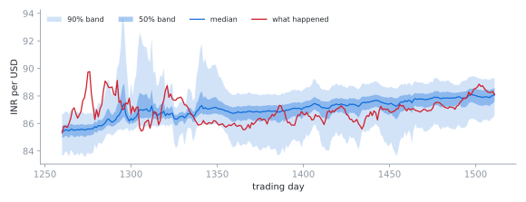

# probability-wave

Forecast an exchange rate as a probability density that flows, rather than as
a single number.

<picture>
  <source media="(prefers-color-scheme: dark)" srcset="docs/fan_dark.svg">
  
</picture>

<sub>The last year of the backtest. Each day the model is fitted to what it has seen so far and pushes a density 20 trading days forward. Bands are the 50% and 90% ranges of that density; red is what actually happened.</sub>

USD/INR is modelled as a slow trend plus a deviation that's pulled back toward
it, with volatility that rises the further the rate strays (local
volatility). Instead of simulating paths, the density of the deviation is
evolved directly with the Fokker-Planck equation

$$\frac{\partial p}{\partial t} = \frac{\partial}{\partial d}\big[\kappa\, d\, p\big] + \frac12 \frac{\partial^2}{\partial d^2}\big[\sigma(d)^2 p\big],$$

on a 600-cell grid. It's the same move a physics engine makes for heat or a
wave packet, which is where the idea came from, applied to probability.

## How it does

`python3 backtest.py` writes [`docs/backtest.md`](docs/backtest.md): **1,312
rolling windows** over six years of daily data, each scored with CRPS, which
rewards a forecast for putting probability where the outcome lands and
penalises it for being over- or under-confident.

| Forecaster | mean CRPS (×1e-3) | vs random walk |
| :-- | --: | --: |
| random walk, window vol | 9.383 | — |
| gradient boosting, 19 quantile models | 8.827 | −5.9% |
| Fokker-Planck | 8.335 | −11.2% |
| Fokker-Planck + empirical-Bayes shrinkage | 8.249 | −12.1% |

Shrinkage pulls each window's noisy estimates of reversion speed and the
vol-curve slope toward what the other windows found, weighted by how noisy
each one is. It cuts CRPS by **1.0%** over the raw model, but a block
bootstrap's 95% interval on that gain still crosses zero, so on this sample
it's a lean, not a result.

The data is **synthetic on purpose**: the trend, reversion speed, vol curve
and vol regimes are all planted, so a forecaster that wins here is reading
structure that's known to be there. Pointing it at real USD/INR history is
next.

## Things that had to be fixed before it worked

The first version lost to a random walk by 60%. Each fix below is in the code
with a comment:

- **A 180-day trend line soaks up the deviation.** The trend now comes from
  all history so far, which is still no lookahead.
- **Least-squares AR(1) overstates mean reversion in short samples**, which
  made the bands too narrow. Corrected with Kendall's (1954) bias term.
- **|residual| regression underestimates vol when vol moves within the
  window.** It now sets the vol curve's shape and the residual RMS sets its
  level.
- **The fitted trend's level is uncertain**, and a model that reverts toward
  it inherits that error. It's now added to the forecast instead of ignored,
  which took 90% band coverage from 66% to 84%. The remaining gap is the vol
  regimes, which the model doesn't include.

## The solver

`python3 test_solver.py` checks it against the one case with a closed form:
with constant volatility the equation is an Ornstein-Uhlenbeck process, whose
transition density is Gaussian.

| Check | Result |
| :-- | :-- |
| density vs. OU closed form, 800 cells | max relative error < 1e-3 |
| halving the grid spacing | error falls by 4.1× (second order) |
| total probability after 80 implicit steps | 1 to within 1e-12 |

It's finite-volume (probability only moves between neighbouring cells, so it
can't leak) and Crank-Nicolson in time (stable at any step size).

```
pwave/
  fokker_planck.py   grid, flux-form operator, Crank-Nicolson stepping
  estimate.py        trend, AR(1) reversion, local-vol fit, EB shrinkage
  forecast.py        fit -> forecast density -> quantiles
  market.py          synthetic USD/INR with planted parameters
  scoring.py         CRPS: exact Gaussian, from a CDF, from quantiles
```
